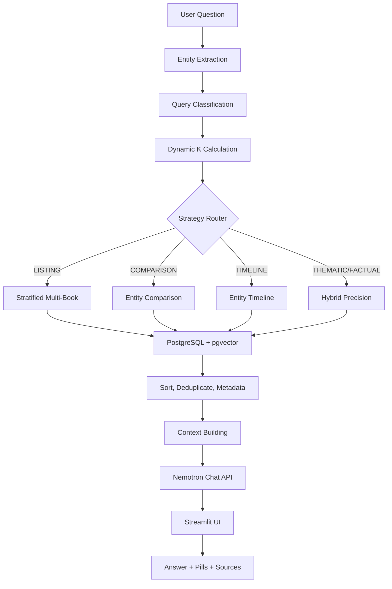

# Multi-Book RAG System - Complete Architecture Documentation

---

## Table of Contents

1. [System Overview](#system-overview)
2. [Architecture Diagram](#architecture-diagram)
3. [Data Flow - Ingestion Pipeline](#data-flow---ingestion-pipeline)
4. [Data Flow - Query Processing](#data-flow---query-processing)
5. [Core Components](#core-components)
6. [Retrieval Strategies](#retrieval-strategies)
7. [Dynamic K Mechanism](#dynamic-k-mechanism)
8. [Entity Detection & Query Classification](#entity-detection--query-classification)
9. [Database Schema](#database-schema)
10. [API & Configuration](#api--configuration)
11. [How to Explain to Others](#how-to-explain-to-others)

---

## System Overview

This is a **generic Retrieval-Augmented Generation (RAG)** system designed to index and query **multiple PDF books** (fiction, non-fiction, mixed). Key differentiators:

| Feature | Description |
|---------|-------------|
| **Multi-Book Support** | Index unlimited PDFs, each can be a compilation (multiple books in one PDF) or single book |
| **Dynamic K Retrieval** | Automatically adjusts chunk count based on query type (3-50 chunks) |
| **Cross-Book Awareness** | Balanced retrieval across all books using PostgreSQL window functions |
| **4 Query Strategies** | Stratified Listing, Entity Comparison, Entity Timeline, Hybrid Precision |
| **Entity-Aware** | Detects characters/places/concepts from questions without hardcoded lists |
| **Streamlit UI** | Chat interface with book management, visual metadata, cross-book views |

---

## Architecture Diagram

```
┌─────────────────────────────────────────────────────────────────────────────┐
│                           MULTI-BOOK RAG SYSTEM                             │
└─────────────────────────────────────────────────────────────────────────────┘

┌──────────────┐     ┌──────────────┐     ┌──────────────┐     ┌──────────────┐
│   USER       │     │   APP.PY     │     │  RETRIEVAL   │     │  DATABASE    │
│  INTERFACE   │────▶│  (STREAMLIT) │────▶│   .PY        │────▶│  (POSTGRESQL │
│  (CHAT UI)   │     │              │     │              │     │  + PGVECTOR) │
└──────────────┘     └──────┬───────┘     └──────┬───────┘     └──────┬───────┘
                            │                    │                    │
                            ▼                    ▼                    ▼
                     ┌──────────────┐     ┌──────────────┐     ┌──────────────┐
                     │  INGEST.PY   │     │  EMBEDDINGS  │     │  VECTOR      │
                     │  (PDF PROC)  │────▶│  (NVIDIA     │────▶│  SEARCH      │
                     │              │     │   NEMOTRON   │     │  (HNSW +     │
                     └──────────────┘     │   3.5 EMBED) │     │   FTS + RRF) │
                                          └──────────────┘     └──────────────┘
```

### Component Interaction Flow

```
┌─────────────────────────────────────────────────────────────────────────────────┐
│                        COMPLETE REQUEST FLOW                                     │
└─────────────────────────────────────────────────────────────────────────────────┘

    USER QUESTION
         │
         ▼
    ┌──────────────────────────────────────────┐
    │         APP.PY - CHAT INTERFACE          │
    │  • Receive user input                    │
    │  • Get scope filter (book/pdf selection) │
    │  • Get K mode (Dynamic vs Manual)        │
    └─────────────────────┬────────────────────┘
                          │
                          ▼
    ┌──────────────────────────────────────────┐
    │         RETRIEVAL.PY - SMART_RETRIEVE    │
    │                                          │
    │  1. CLASSIFY QUERY                       │
    │     ├── Extract entities                 │
    │     ├── Match regex patterns             │
    │     ├── Determine query type             │
    │     └── Calculate confidence             │
    │                                          │
    │  2. CALCULATE DYNAMIC K                  │
    │     ├── Get book/chapter count from DB   │
    │     ├── Apply per-type formula           │
    │     └── Clamp to min/max bounds          │
    │                                          │
    │  3. ROUTE TO STRATEGY                    │
    │     ├── LISTING → stratified_multi_book  │
    │     ├── COMPARISON → entity_comparison   │
    │     ├── TIMELINE → entity_timeline       │
    │     └── THEMATIC/FACTUAL → hybrid_precision
    │                                          │
    │  4. EXECUTE SEARCH (via DATABASE.PY)     │
    │     ├── Vector similarity (cosine)       │
    │     ├── Full-text search (PostgreSQL)    │
    │     ├── RRF fusion / Window functions    │
    │     └── Filter by scope if specified     │
    │                                          │
    │  5. POST-PROCESS                         │
    │     ├── Sort by book + page              │
    │     ├── Deduplicate                      │
    │     ├── Build metadata (distribution,    │
    │     │   strategy, entities, confidence)  │
    │     └── Return chunks + metadata         │
    └─────────────────────┬────────────────────┘
                          │
                          ▼
    ┌──────────────────────────────────────────┐
    │         APP.PY - ANSWER GENERATION       │
    │                                          │
    │  • Build context from chunks             │
    │  • Select system prompt by query type    │
    │  • Call NVIDIA Nemotron Chat API         │
    │  • Stream answer to UI                   │
    │  • Show retrieval metadata pills         │
    │  • Show cross-book view (if applicable)  │
    │  • Show expandable source passages       │
    └──────────────────────────────────────────┘
```

---

## Data Flow - Ingestion Pipeline

```
┌─────────────────────────────────────────────────────────────────────────────────┐
│                        INGESTION PIPELINE (ingest.py)                           │
└─────────────────────────────────────────────────────────────────────────────────┘

    SCAN BOOKS/ FOLDER
         │
         ▼
    ┌──────────────────────────────────────────┐
    │ FOR EACH PDF FILE                        │
    │                                          │
    │ 1. READ PDF OUTLINE (BOOKMARKS/TOC)      │
    │    ├── If outline exists → COMPILATION   │
    │    │   Extract: book_title, start_page,  │
    │    │   end_page for each chapter         │
    │    │                                      │
    │    └── If no outline → SINGLE BOOK       │
    │        Title from filename               │
    │        Pages 1 to end                    │
    └─────────────────────┬────────────────────┘
                          │
                          ▼
    ┌──────────────────────────────────────────┐
    │ FOR EACH BOOK RANGE                      │
    │                                          │
    │ 1. CHECK IF ALREADY INDEXED              │
    │    └── Skip if exists (deduplication)    │
    │                                          │
    │ 2. EXTRACT TEXT (extract_pdf_pages_range)│
    │    ├── Skip empty pages (scanned PDFs)   │
    │    ├── Normalize whitespace              │
    │    └── Return: [{page, text}, ...]       │
    │                                          │
    │ 3. CHUNK TEXT (chunk_pages)              │
    │    ├── CHUNK_SIZE = 1200 chars           │
    │    ├── CHUNK_OVERLAP = 300 chars         │
    │    └── Return: [{text, page}, ...]       │
    │                                          │
    │ 4. GENERATE EMBEDDINGS (create_embeddings)│
    │    ├── Parallel: ThreadPoolExecutor(8)   │
    │    ├── NVIDIA Nemotron 3.5 Embed 1B      │
    │    ├── Retry with exponential backoff    │
    │    └── Return: [[float], ...] 2048-dim   │
    │                                          │
    │ 5. INSERT INTO DATABASE                  │
    │    ├── Batch INSERT via executemany      │
    │    ├── Columns: source_id, filename,     │
    │    │   book_title, page, chunk_idx,      │
    │    │   content, embedding                │
    │    └── Commit transaction                │
    └─────────────────────┬────────────────────┘
                          │
                          ▼
                    INDEX COMPLETE
```

### Ingestion Configuration

```python
# ingest.py constants
CHUNK_SIZE = 1200        # Characters per chunk
CHUNK_OVERLAP = 300      # Overlap between chunks
MAX_EMBED_WORKERS = 8    # Parallel embedding requests
```

---

## Data Flow - Query Processing

```
┌─────────────────────────────────────────────────────────────────────────────────┐
│                        QUERY PROCESSING (retrieval.py)                          │
└─────────────────────────────────────────────────────────────────────────────────┘

    USER QUESTION: "Compare Mowgli and Harry Potter"
         │
         ▼
    ┌──────────────────────────────────────────┐
    │ 1. ENTITY EXTRACTION                     │
    │    extract_entities(question)            │
    │                                          │
    │    • Normalize: "Harry Potter's" → "Harry Potter" │
    │    • Remove first word if stop word      │
    │    • Find multi-word: "Harry Potter"     │
    │    • Find single: "Mowgli"               │
    │    • Filter stop words                   │
    │    • Deduplicate (prefer longer)         │
    │                                          │
    │    RESULT: ["Harry Potter", "Mowgli"]    │
    └─────────────────────┬────────────────────┘
                          │
                          ▼
    ┌──────────────────────────────────────────┐
    │ 2. QUERY CLASSIFICATION                  │
    │    classify_query(question)              │
    │                                          │
    │    Patterns matched:                     │
    │    • "compare" → COMPARISON (weight 1.0) │
    │    • "versus" → COMPARISON (weight 1.0)  │
    │    Score = 2.0 → confidence = 0.67       │
    │                                          │
    │    RESULT: ("COMPARISON", 0.67,          │
    │             ["Harry Potter", "Mowgli"])  │
    └─────────────────────┬────────────────────┘
                          │
                          ▼
    ┌──────────────────────────────────────────┐
    │ 3. DYNAMIC K CALCULATION                 │
    │    calculate_dynamic_k()                 │
    │                                          │
    │    Config for COMPARISON:                │
    │    base=20, per_entity=10, min=15, max=40│
    │                                          │
    │    book_count = 2 (Jungle Book + HP)     │
    │    entity_count = 2                      │
    │    k = 10 * 2 = 20                       │
    │    clamp(15, 40, 20) = 20                │
    │                                          │
    │    RESULT: final_k = 20                  │
    └─────────────────────┬────────────────────┘
                          │
                          ▼
    ┌──────────────────────────────────────────┐
    │ 4. STRATEGY ROUTING                      │
    │                                          │
    │    query_type == "COMPARISON"            │
    │    AND scope == "All Books"              │
    │                                          │
    │    → strategy_entity_comparison()        │
    └─────────────────────┬────────────────────┘
                          │
                          ▼
    ┌──────────────────────────────────────────┐
    │ 5. ENTITY COMPARISON STRATEGY            │
    │    strategy_entity_comparison()          │
    │                                          │
    │    FOR EACH ENTITY (Harry Potter, Mowgli)│
    │    ├── Build entity query:               │
    │    │   "Harry Potter character           │
    │    │    personality development role     │
    │    │    relationships story arc"         │
    │    ├── Embed query                       │
    │    ├── search_chunks_by_entity()         │
    │    │   ├── FTS: "Harry Potter"           │
    │    │   ├── Vector: similarity            │
    │    │   ├── Per-book window function      │
    │    │   └── Return top per_book_k/book    │
    │    └── Collect chunks                    │
    │                                          │
    │    BALANCE: Round-robin merge by entity  │
    │    LIMIT: final_k (20)                   │
    └─────────────────────┬────────────────────┘
                          │
                          ▼
    ┌──────────────────────────────────────────┐
    │ 6. POST-PROCESS & METADATA               │
    │                                          │
    │    • Sort by book_title, page_number     │
    │    • Deduplicate by chunk ID             │
    │    • Build book_distribution:            │
    │      {"The Jungle Book": 10,             │
    │       "Harry Potter": 10}                │
    │    • Metadata: {                         │
    │        query_type: "COMPARISON",         │
    │        strategy: "entity_comparison",    │
    │        dynamic_k: 20,                    │
    │        entities: ["Harry Potter",        │
    │                  "Mowgli"],              │
    │        confidence: 0.67,                 │
    │        book_distribution: {...},         │
    │        reasoning: "Comparison of...      │
    │                  sub-query decomposition │
    │                  per entity"             │
    │      }                                   │
    └─────────────────────┬────────────────────┘
                          │
                          ▼
                    RETURN TO APP.PY
```

---

## Core Components

### 1. `database.py` - PostgreSQL + pgvector Layer

```python
# Core Functions
init_db()                    # Create tables, indexes, extensions
get_connection()             # Psycopg connection with vector support

# Search Functions
search_chunks()              # Pure vector cosine similarity
search_chunks_hybrid()       # Vector + FTS with RRF (Reciprocal Rank Fusion)
search_chunks_stratified()   # Window functions: per-book top-K
search_chunks_by_entity()    # Entity FTS + vector, stratified

# Management
get_db_stats()               # Total chunks, books, per-book counts
get_all_books()              # List all indexed books with stats
delete_book()                # Delete by book_title
clear_all_chunks()           # Truncate table
```

#### Key Indexes Created

```sql
-- B-tree for metadata filtering
CREATE INDEX idx_doc_chunks_source ON document_chunks(source_id);
CREATE INDEX idx_doc_chunks_filename ON document_chunks(filename);
CREATE INDEX idx_doc_chunks_book_title ON document_chunks(book_title);

-- GIN for Full-Text Search
CREATE INDEX idx_doc_chunks_fts 
ON document_chunks USING gin(to_tsvector('english', content));

-- HNSW for Vector Similarity (approximate, fast)
CREATE INDEX idx_doc_chunks_halfvec 
ON document_chunks USING hnsw ((embedding::halfvec(2048)) halfvec_cosine_ops);
```

### 2. `ingest.py` - PDF Processing Pipeline

```python
# Text Extraction
extract_pdf_pages_range(file, start, end) 
    # → [{page, text}, ...]  (skips empty pages)

# Chunking
chunk_pages(pages) 
    # → [{text, page}, ...]  (1200 chars, 300 overlap)

# Embeddings (Parallel)
create_embeddings(texts, input_type="passage") 
    # → [[float], ...]  (ThreadPoolExecutor, 8 workers)

# Book Detection
get_compilation_book_ranges(reader) 
    # → [{book_title, start_page, end_page}, ...] from PDF outline

# Main Entry
scan_and_ingest_books(books_dir, progress_callback)
    # Handles both compilation PDFs and single-book PDFs
```

### 3. `retrieval.py` - Smart Retrieval Engine

```python
# Query Analysis
extract_entities(question) → List[str]
classify_query(question) → (query_type, confidence, entities)
calculate_dynamic_k(query_type, entities, book_count) → int

# Strategies
strategy_stratified_listing()      # LISTING: per-book top-K via window fn
strategy_entity_comparison()       # COMPARISON: sub-queries per entity
strategy_entity_timeline()         # TIMELINE: entity chronological search
strategy_hybrid_precision()        # THEMATIC/FACTUAL: RRF vector+FTS

# Main Entry
smart_retrieve(question, book_filter, manual_k) 
    → (chunks: List[Dict], metadata: Dict)

# UI Helpers
get_query_suggestions(query_type) → List[(label, question)]
```

### 4. `app.py` - Streamlit Interface

```python
# State Management
st.session_state.messages          # Chat history with metadata
st.session_state.pending_question  # From suggestion pills
st.session_state.show_book_manager # Book manager toggle

# UI Sections
├── Sidebar
│   ├── Knowledge Base Stats
│   ├── Upload PDFs
│   ├── Search Scope (grouped by PDF)
│   ├── Dynamic K / Manual K toggle
│   ├── PDF Files list with index status
│   ├── Sync/Index Button
│   ├── Book Manager (expandable)
│   └── Clear Chat/DB buttons
│
├── Main
│   ├── Title + Subtitle
│   ├── Suggestion Pills (dynamic)
│   ├── Query Type Quick-Selector
│   ├── Chat History
│   │   ├── User messages
│   │   └── Assistant messages
│   │       ├── Retrieval metadata pill
│   │       ├── Cross-book view (tabs)
│   │       ├── Answer
│   │       └── Expandable sources (grouped by book)
│   └── Chat Input
```

---

## Retrieval Strategies

### Strategy Comparison Table

| Strategy | Query Type | Key Technique | Books Covered | Best For |
|----------|------------|---------------|---------------|----------|
| **Stratified Multi-Book** | LISTING | `ROW_NUMBER() OVER (PARTITION BY book_title)` | All (balanced) | "List all characters", "All themes" |
| **Entity Comparison** | COMPARISON | Sub-query per entity + round-robin merge | All (entity-focused) | "Compare X and Y", "Differences between..." |
| **Entity Timeline** | TIMELINE | Entity FTS + vector, stratified | All (chronological) | "Timeline of X", "Major events in X's life" |
| **Hybrid Precision** | THEMATIC/FACTUAL | RRF: Vector + FTS + gap pruning | Filtered or All | "Why did...", "What is...", "Who is..." |

### 1. Stratified Multi-Book (LISTING)

```sql
-- PostgreSQL Window Function
WITH ranked_chunks AS (
    SELECT *,
        ROW_NUMBER() OVER (
            PARTITION BY book_title
            ORDER BY embedding <=> query_vector
        ) AS rank_in_book
    FROM document_chunks
    WHERE embedding <=> query_vector <= 0.68
       OR content @@ fts_query
)
SELECT * FROM ranked_chunks
WHERE rank_in_book <= per_book_k
ORDER BY book_title, page_number;
```

**Guarantees**: Each book contributes up to `per_book_k` chunks → balanced representation.

### 2. Entity Comparison (COMPARISON)

```python
# For each entity, search across all books
for entity in entities:
    entity_query = f"{entity} character personality development..."
    q_vec = embed(entity_query)
    chunks = search_chunks_by_entity(entity, q_vec, per_book_k)

# Round-robin merge for balanced entity representation
balanced = []
for i in range(max_chunks_per_entity):
    for entity in entities:
        if i < len(entity_chunks[entity]):
            balanced.append(entity_chunks[entity][i])
```

### 3. Entity Timeline (TIMELINE)

```python
# Focus on primary entity, chronological across books
target_entity = entities[0]
q_text = f"{target_entity} major events actions story key moments timeline"
chunks = search_chunks_by_entity(target_entity, q_vec, per_book_k)
# Returns ordered by book_title, page_number → chronological within each book
```

### 4. Hybrid Precision (THEMATIC/FACTUAL)

```sql
-- Reciprocal Rank Fusion (RRF)
WITH candidates AS (
    SELECT *,
        ROW_NUMBER() OVER (ORDER BY embedding <=> query_vector) AS vec_rank,
        ROW_NUMBER() OVER (ORDER BY ts_rank(...) DESC) AS fts_rank
    FROM document_chunks
    WHERE embedding <=> query_vector < 0.68
       OR content @@ fts_query
    LIMIT 60
)
SELECT *,
    (1.0/(60+vec_rank)) + (1.0/(60+fts_rank)) AS rrf_score
FROM candidates
ORDER BY rrf_score DESC
LIMIT top_k;
```

**Gap Pruning**: Stops when distance jumps > 0.15 or distance > 0.62.

---

## Dynamic K Mechanism

### Configuration

```python
DYNAMIC_K_CONFIG = {
    "LISTING":      {"base": 21, "per_book": 3,  "min": 15, "max": 50},
    "COMPARISON":   {"base": 20, "per_entity": 10, "min": 15, "max": 40},
    "TIMELINE":     {"base": 18, "per_book": 2,  "min": 12, "max": 35},
    "THEMATIC":     {"base": 10, "per_book": 1,  "min": 8,  "max": 20},
    "FACTUAL":      {"base": 5,  "per_book": 0,  "min": 3,  "max": 10},
}
```

### Calculation Logic

```python
def calculate_dynamic_k(query_type, entities, book_count):
    config = DYNAMIC_K_CONFIG[query_type]
    
    if query_type == "LISTING":
        k = config["per_book"] * book_count           # 3 × books
    elif query_type == "COMPARISON":
        entity_count = max(2, len(entities))
        k = config["per_entity"] * entity_count       # 10 × entities
    elif query_type == "TIMELINE":
        k = config["base"] + config["per_book"] * (book_count - 1)
    elif query_type == "THEMATIC":
        k = config["base"] + config["per_book"] * book_count
    else:  # FACTUAL
        k = config["base"]
    
    return clamp(config["min"], config["max"], k)
```

### Examples

| Query | Type | Books | Entities | Calculation | Final K |
|-------|------|-------|----------|-------------|---------|
| "List all characters" | LISTING | 2 | 0 | 3 × 2 = 6 → clamp(15,50) | **15** |
| "Compare Harry and Mowgli" | COMPARISON | 2 | 2 | 10 × 2 = 20 | **20** |
| "Timeline of Harry" | TIMELINE | 2 | 1 | 18 + 2×1 = 20 | **20** |
| "Why did Harry choose?" | THEMATIC | 2 | 0 | 10 + 1×2 = 12 | **12** |
| "What is the capital?" | FACTUAL | 2 | 0 | 5 | **5** |

---

## Entity Detection & Query Classification

### Entity Extraction Pipeline

```
QUESTION: "Summarize Harry Potter's journey across the books"

1. NORMALIZE POSSESSIVE
   "Harry Potter's" → "Harry Potter"

2. REMOVE FIRST WORD IF STOP WORD
   First word: "Summarize" (in EXTENDED_STOP_WORDS)
   Extraction text: "Harry Potter journey across the books"

3. FIND MULTI-WORD ENTITIES (capitalized phrases)
   → ["Harry Potter"]

4. FIND SINGLE WORD ENTITIES
   → ["Harry", "Potter", "Journey"]

5. FILTER & DEDUPLICATE
   - Multi-word set: {"Harry", "Potter"}
   - Singles not in multi-word: ["Journey"]
   - Remove stop words: "Journey" not in stop list
   - Keep longest: "Harry Potter" (len 12) > "Journey" (len 7)

RESULT: ["Harry Potter"]
```

### Query Classification Patterns

```python
QUERY_PATTERNS = {
    "LISTING": [
        r"\blist\s+(all|every|the)\b",
        r"\ball\s+(characters?|themes?|books?)\b",
        r"\bacross\s+all\s+books?\b",
        r"\benumerate\b",
        r"\bcatalog\b",
    ],
    "COMPARISON": [
        r"\bcompare\b", r"\bcontrast\b", r"\bversus\b", r"\bvs\.?\b",
        r"\bdifference\s+between\b", r"\bdiffer\b",
        r"\bsimilarities\b", r"\bdifferences\b",
    ],
    "TIMELINE": [
        r"\btimeline\b", r"\bmajor\s+events\b",
        r"\blife\s+of\b", r"\bstory\s+of\b", r"\bhistory\s+of\b",
        r"\bjourney\s+of\b", r"\bsummarize\s+\w+.*journey\b",
    ],
    "THEMATIC": [
        r"\bwhy\s+did\b", r"\bhow\s+did\b", r"\bexplain\s+(why|how)\b",
        r"\bwhat\s+led\s+to\b", r"\bcause\s+of\b",
    ],
}
```

### Confidence Calculation

```python
# Each pattern match adds weight (1.0)
# Max patterns per type ≈ 3-4
confidence = min(total_score / 3.0, 1.0)

# Examples:
"Compare X and Y"           → 1 match → 33%
"Compare and contrast X vs Y" → 3 matches → 100%
"List all characters"       → 2 matches → 67%
```

---

## Database Schema

```sql
CREATE TABLE document_chunks (
    id              BIGSERIAL PRIMARY KEY,
    source_id       VARCHAR(64) NOT NULL,      -- filename_start_end
    filename        VARCHAR(255) NOT NULL,     -- original PDF filename
    book_title      VARCHAR(255) NOT NULL,     -- human-readable title
    page_number     INTEGER NOT NULL,          -- page in PDF
    chunk_index     INTEGER NOT NULL,          -- order within book
    content         TEXT NOT NULL,             -- chunk text
    embedding       vector(2048),              -- Nemotron 3.5 Embed
    created_at      TIMESTAMPTZ DEFAULT NOW()
);

-- Indexes
CREATE INDEX idx_doc_chunks_source ON document_chunks(source_id);
CREATE INDEX idx_doc_chunks_filename ON document_chunks(filename);
CREATE INDEX idx_doc_chunks_book_title ON document_chunks(book_title);
CREATE INDEX idx_doc_chunks_fts 
    ON document_chunks USING gin(to_tsvector('english', content));
CREATE INDEX idx_doc_chunks_halfvec 
    ON document_chunks USING hnsw ((embedding::halfvec(2048)) halfvec_cosine_ops);
```

### Data Model

```
PDF FILE (e.g., "harrypotter.pdf")
    │
    ├── Book: "Harry Potter and the Sorcerer's Stone" (pages 1-200)
    │   ├── Chunk 0: page 1, text "...", embedding [...]
    │   ├── Chunk 1: page 1, text "...", embedding [...]
    │   └── ...
    │
    ├── Book: "Harry Potter and the Chamber of Secrets" (pages 201-400)
    │   └── ...
    │
    └── ... (7 chapters/books total)

Jungle Book PDF → Single book "The Jungle Book" (if no outline)
```

---

## API & Configuration

### Environment Variables (`.env`)

```env
# NVIDIA API
NVIDIA_API_KEY=your_key
NVIDIA_BASE_URL=https://integrate.api.nvidia.com/v1
NVIDIA_CHAT_MODEL=nvidia/nemotron-3.5-bolt-e4b
NVIDIA_EMBED_MODEL=nvidia/nemotron-3.5-embed-1b

# PostgreSQL
PGHOST=localhost
PGPORT=5432
PGDATABASE=ragdb
PGUSER=raguser
PGPASSWORD=ragpassword
```

### Models Used

| Purpose | Model | Dimensions |
|---------|-------|------------|
| Chat/Generation | Nemotron 3.5 Bolt E4B | - |
| Embeddings | Nemotron 3.5 Embed 1B | 2048 |

### Running the System

```bash
# 1. Start PostgreSQL with pgvector
docker run -d --name pgvector \
  -e POSTGRES_DB=ragdb -e POSTGRES_USER=raguser \
  -e POSTGRES_PASSWORD=ragpassword -p 5432:5432 \
  pgvector/pgvector:pg16

# 2. Install dependencies
pip install -r requirements.txt

# 3. Add PDFs to books/ folder or upload via UI

# 4. Run app
streamlit run app.py

# 5. Click "Sync / Index Books" in sidebar
```

---

## How to Explain to Others

### 30-Second Elevator Pitch

> "This is a **multi-book RAG system** that lets you upload any number of PDF books and ask questions across them. It automatically detects what type of question you're asking—listing, comparison, timeline, or factual—and adjusts how many passages it retrieves from each book. It uses PostgreSQL with pgvector for storage, NVIDIA Nemotron models for embeddings and generation, and has a Streamlit chat interface with visual metadata showing exactly which books and pages were used."

### 2-Minute Technical Explanation

**Ingestion:**
1. PDFs dropped in `books/` folder
2. System detects if PDF has outline (compilation) or is single book
3. Extracts text per page range, chunks at 1200 chars with 300 overlap
4. Generates 2048-dim embeddings in parallel (8 workers) via NVIDIA Nemotron
5. Stores in PostgreSQL with pgvector (HNSW index + FTS GIN index)

**Query Processing:**
1. User asks question in Streamlit chat
2. **Entity extraction** finds capitalized names (handles possessives, filters question words)
3. **Query classification** matches regex patterns → LISTING/COMPARISON/TIMELINE/THEMATIC/FACTUAL
4. **Dynamic K** calculates optimal chunks based on type, entity count, book count
5. **Strategy routing** picks 1 of 4 retrieval methods
6. **Database search** uses vector similarity, FTS, or window functions
7. **Post-process**: sort by book/page, deduplicate, build metadata
8. **Generation** builds context, selects type-specific prompt, calls Nemotron chat
9. **UI displays** answer + retrieval pills + cross-book tabs + expandable sources

### Key Differentiators to Highlight

| Feature | Why It Matters |
|---------|----------------|
| **Stratified retrieval** | Prevents one book dominating results; guarantees each book represented |
| **Dynamic K** | Factual questions get 5 chunks (fast, precise); listings get 50 (comprehensive) |
| **Implicit cross-book comparison** | "Compare protagonists" works without naming characters |
| **Entity-aware** | Detects "Harry Potter" as single entity, not "Harry" + "Potter" |
| **Visual metadata** | Users see exactly which books, how many chunks, confidence, strategy |
| **Compilation PDF support** | One PDF with bookmarks → multiple indexed books automatically |

### Diagrams for Presentations

Use the ASCII diagrams above, or convert to Mermaid:



---

## File Reference

```
RAG-PDF-VectorDB/
├── app.py              # Streamlit UI, chat, book management
├── database.py         # PostgreSQL + pgvector operations
├── ingest.py           # PDF extraction, chunking, embedding, indexing
├── retrieval.py        # Query analysis, Dynamic K, 4 strategies
├── requirements.txt    # Dependencies
├── .env                # Configuration (create from .env.example)
├── books/              # PDF storage (gitignored)
├── test_db.py          # Database connection test
├── test_vector.py      # Vector operations test
├── test_retrieval.py   # Query analysis tests
└── README.md           # Project documentation
```

---

*Documentation generated for Multi-Book RAG Assistant v1.0*